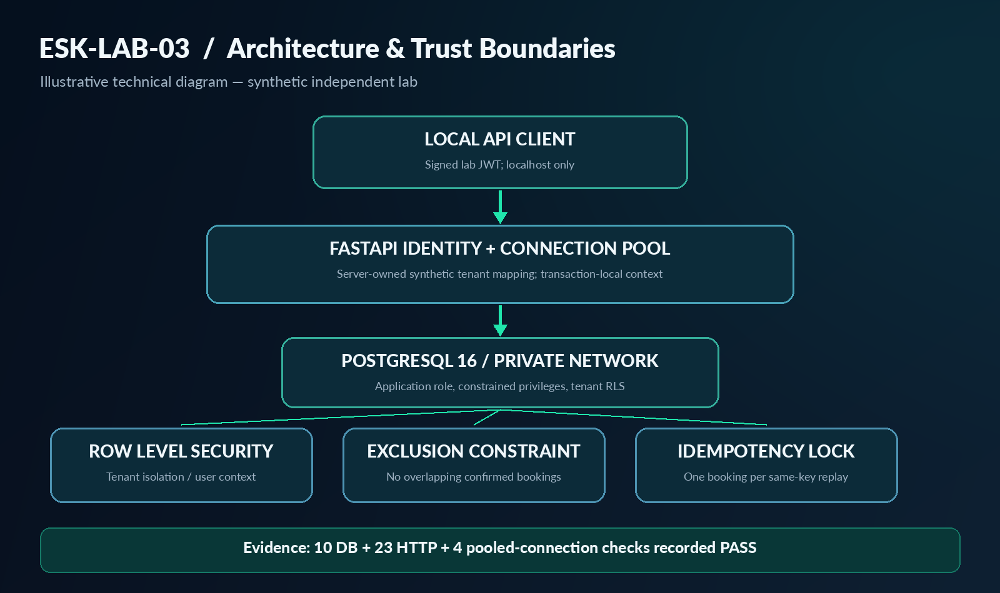

# Eskelsen Multi-Tenant Booking & Security Lab

An independent, synthetic FastAPI and PostgreSQL demonstration by Eskelsen Systems.

## Verified results

37 functional checks passed in the original laboratory and again after
reconstruction from the verified review ZIP using fresh database storage
and a separately built runtime image.

- 10 database isolation and integrity checks.
- 23 HTTP authentication, authorization, booking and idempotency checks.
- 4 application-role and pooled-connection checks.
- 12 competing booking requests: one accepted booking, eleven conflicts.
- 12 identical keyed requests: one booking, one original and eleven replays.
- 40 alternating tenant transactions reused one backend without context leakage.

See evidence/. These checks are not throughput benchmarks or a certified audit.

## Architecture

JWT authentication maps known synthetic subjects to server-owned tenants.
The API rejects client-supplied tenant fields. PostgreSQL RLS adds isolation.
Transaction-local tenant settings prevent context leaking between transactions.
A PostgreSQL exclusion constraint prevents overlapping confirmed reservations.
Transaction-scoped advisory locks serialize identical idempotency keys.

PostgreSQL uses an internal network with no published ports.
The non-root API also uses a bridge network and binds to localhost only.

## Requirements

Windows PowerShell 5.1, Docker Desktop with Linux containers and desktop-linux
context, internet access for dependencies/images, and free port 18083.

## Clean setup

From a clean extracted project root:

    & .\scripts\Initialize-Lab.ps1

The initializer deliberately refuses existing .env/data and conflicting
LAB03 container, network or runtime image names. Preserve existing laboratories.
Do not initialize the already configured project.

If execution policy blocks the script, inspect its contents and paste them into
PowerShell. Do not change machine-wide execution policy.

API: http://127.0.0.1:18083
OpenAPI UI: http://127.0.0.1:18083/docs

There is no public token issuance endpoint. The automated HTTP test creates
short-lived synthetic tokens inside the API container without printing them.

## Run verification

Run separately and check each native command exit code:

    docker cp .\tests\db_isolation_checks.sql esk-lab03-db:/tmp/lab03_db_checks.sql
    docker exec esk-lab03-db psql -X -U lab03_owner -d booking_lab -v ON_ERROR_STOP=1 -f /tmp/lab03_db_checks.sql
    Get-Content -Raw .\tests\http_checks.py | docker exec -i esk-lab03-api python -
    Get-Content -Raw .\tests\pool_isolation_checks.py | docker exec -i esk-lab03-api python -

Save actual terminal output. HTTP checks create synthetic reservations and
cancel tracked reservations during cleanup; history remains in PostgreSQL.

## Reconstruction provenance

The recorded reconstruction started from review ZIP SHA-256:
481BB6826D883A085F7EA2C528D40769003CE408B28B4162B1A4A2C509275C3D

Only deployment names changed from esk-lab03 to esk-lab03-repro and the host
port from 18083 to 18084, allowing coexistence. Application, SQL and test sources
were unchanged. Original container identities were checked afterward.

The original machine-specific reconstruction script is retained in the delivery's
private verification folder, not in this public repository. It includes absolute
paths and should not be reused as a portable installer. `Initialize-Lab.ps1` is
the clean setup entry point.

This publication package updates documentation, adds independently checked
SHA-256 manifests, and includes a static-only GitHub Actions check. The final
public repository version has **not** undergone another full integrated
reconstruction after publication-only changes.
Dependency versions are captured; base image tags remain mutable.
This is functional reconstruction evidence, not byte-for-byte reproducibility.

## Operations

    docker compose -p esk-lab03 -f compose.yaml -f compose.api.yaml -f compose.local.yaml ps
    docker compose -p esk-lab03 -f compose.yaml -f compose.api.yaml -f compose.local.yaml stop

Stopping services preserves database data.

## Limitations

Synthetic static identities; no registration, password login, revocation,
external identity provider, rate limiting or production deployment.
Anyone with the local JWT secret can mint laboratory tokens.
RLS assumes trusted application code controls tenant settings; it does not
protect against arbitrary SQL execution with application credentials.

Idempotent replays return the same booking with its current state.
DELETE means cancellation, preserving history and idempotency references.
No independent penetration test, comprehensive log audit, backup/recovery
validation, regulatory compliance or availability/scale certification is claimed.

## License

Original project code is MIT licensed. Third-party dependencies retain their
own licenses. Dependency license compatibility has not been separately audited.
No third-party dependency binaries or container images are distributed here.

## Evidence and privacy

Selected reconstruction outputs are included with the local project path
replaced by `<PROJECT_ROOT>`. Original raw evidence remains in the private
working project. Secrets, database storage, other-lab inventories and previous
ZIP files are excluded. Upload to GitHub/Upwork is performed by the owner.

## Additional documentation

- [Architecture and security boundaries](docs/ARCHITECTURE.md)
- [Test matrix and results provenance](docs/TEST_MATRIX.md)
- [Known limitations and nonclaims](docs/SECURITY_LIMITATIONS.md)
- [GitHub publication guide](docs/GITHUB_PUBLICATION.md)
- `python scripts/verify_release.py` validates the published file manifest.
- `.github/workflows/static-release-check.yml` runs **static-only** checks.
  CI green is **not** a claim of running the PostgreSQL or HTTP integration tests.

**Release note:** ESK-LAB-03 independent demo; 37 checks are evidenced by
original and reconstructed runs. The presentation graphics are illustrations,
not captured authenticated product screens or security certifications.