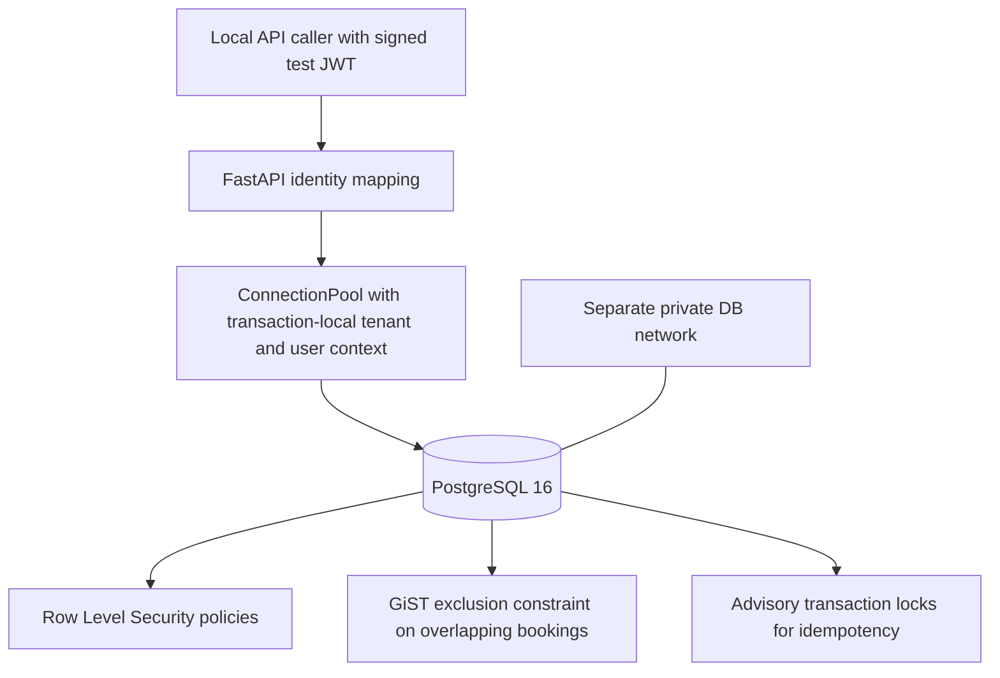

# LAB-03 architecture and security boundaries

**Purpose:** synthetic demonstration of multitenant booking isolation and
concurrent reservation correctness using FastAPI, PostgreSQL, Docker.

## Key invariants

1. A signed JWT subject maps to a **fixed synthetic server-owned identity**; request body or extra tenant claims do not select a tenant.
2. The API sets tenant/user PostgreSQL settings **locally in each transaction** and does not intentionally carry them across pooled sessions.
3. RLS restricts tenant-owned records, and identity-key records also require matching synthetic user context.
4. A PostgreSQL exclusion constraint rejects overlapping **confirmed** bookings for the same tenant and professional. Adjacent intervals are allowed.
5. An advisory xact lock serializes repeated requests with the same user/tenant/idempotency key and the stored body fingerprint catches mismatched payloads.
6. Cancellation leaves original booking history and idempotency references intact.

## Scope and trust model

This is not an authorization or identity product. The registry has only two
synthetic users, there is no token issuance endpoint, no client-role/admin-role
model and no account lifecycle. PostgreSQL custom GUCs are set by trusted
application code; this does **not** stop a compromised app connection from
changing its own tenant context through arbitrary SQL. Treat SQL injection
prevention and app role custody as critical assumptions.

The DB has no published host ports. The API binds to `127.0.0.1:18083` on
the local computer. It is not intended to be exposed publicly.
